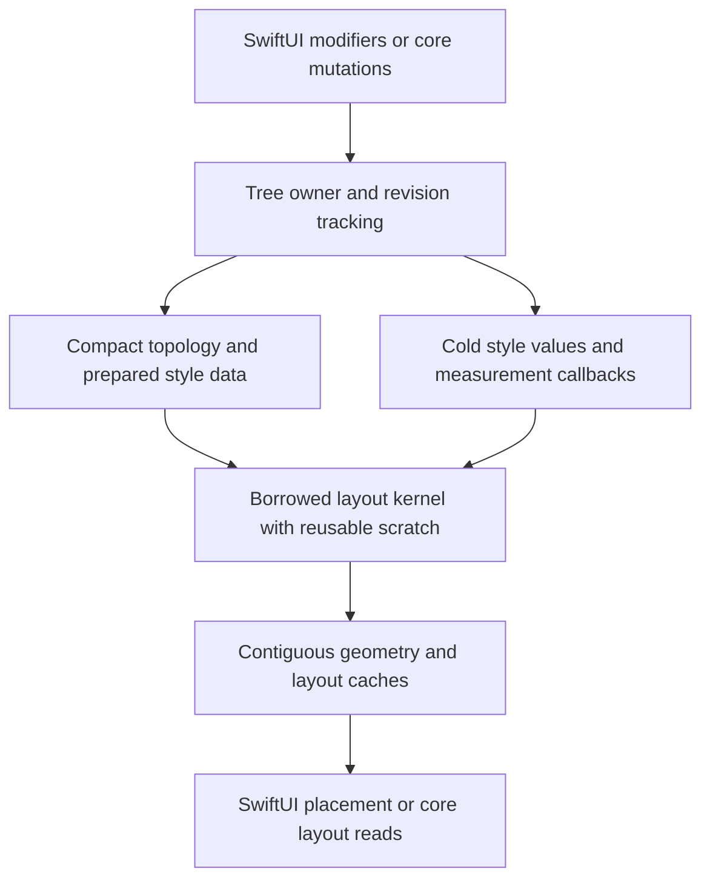

# Performance plan for Yoga 3.0

Status: engineering plan from September 29, 2026. The storage architecture, construction and retained-layout optimizations, and verification harness are implemented. macOS, Linux aarch64, and physical-iPhone correctness are verified. See the [implementation review](PerformanceImplementation.md) for measured outcomes and remaining targets, including the narrow miss of the strict construction criterion. The proposals below record the original plan; they are not all implemented or achieved.

## Objective

Build a native Swift flexbox engine that consistently uses fewer CPU cycles and less memory than the optimized C++ reference, while preserving layout behavior. Keep `Yoga` independent of SwiftUI and C++; make `YogaSwiftUI` use the same engine efficiently through its existing modifiers.

The recommended direction is **one owner for tree storage, compact node identifiers, contiguous working data, and borrowed access through the layout kernel**. Most of the initial effort should remove copying, reference counting, allocations, and repeated work. More aggressive compiler tuning comes after those changes have measurable results.

## 1. Starting evidence

The [pre-optimization benchmark](../Benchmarks/results/before-optimization.json) used Apple Swift 6.4 on an M4 Pro, with Yoga 3.2.1 as the C++ reference. Ratios are Swift divided by C++; lower is better.

| Workload | Rebuild cycles | Resized layout cycles | Retained heap |
| --- | ---: | ---: | ---: |
| Flat | 1.767 | 1.474 | 0.608 |
| Wrapping | 1.645 | 1.474 | 0.609 |
| Deep tree | 2.220 | 2.046 | 0.883 |
| Measured content | 1.812 | 1.363 | 0.755 |
| Absolute positioning | 2.085 | 1.816 | 0.627 |
| Display contents | 1.662 | 1.367 | 0.617 |

The starting engine saved roughly 12–39% of retained heap on these trees. It needed a substantial CPU improvement. The measured 1–3% reduction in complete SwiftUI layout cycles versus v2 is small enough to require stronger statistical validation before making a performance claim.

Additional three-second profiles of the release executable, sampled at one-millisecond intervals, identify these recurring costs:

| Selected top-of-stack symbol | Flat samples | Deep samples |
| --- | ---: | ---: |
| `initializeWithCopy for YogaStyle` | 344 | 289 |
| `swift_release` | 188 | 181 |
| `swift_beginAccess` | 186 | 151 |
| `swift_retain` | 163 | 125 |
| Outlined initialization with a style copy | 92 | 76 |

These are diagnostic sample counts, not exact call counts or percentages of total execution. Deep layouts also sample reference-count slow paths prominently. Code inspection finds per-container `flow` allocations, repeated child flattening, repeated edge resolution, and copies of styles that contain an array.

The raw reports show another useful clue: flat relayout uses about 1.10× the instructions but 1.47× the cycles of C++; deep relayout uses about 1.43× the instructions and 2.05× the cycles. Extra instructions explain only part of the gap. Cache locality, branching, and serialized runtime operations are hypotheses to investigate with hardware counters, not conclusions established by these ratios.

Baseline Swift source digest: `5383e9c4172c91b32c6f6ff02dc2365f113dc183d7fa5e25345aa6f7f4eac301`. Retain the [raw core](../Benchmarks/results/before-optimization.json) and [SwiftUI](../Benchmarks/results/swiftui-before-optimization.json) reports when comparing subsequent revisions.

## 2. Proposed success criteria

Freeze the workload matrix before optimizing it. Evaluate the following targets separately on each designated reference machine. These are engineering goals; feasibility must be established by experiments.

| Measure | Release performance target | Exceptional stretch target |
| --- | --- | --- |
| Rebuild and resized layout CPU cycles | At least 20% fewer than C++, separately for each mode | 1.5–2× throughput on the declared representative suite, with elapsed time confirming the cycle gain |
| Retained engine heap after layout | At least 30% less than C++ overall | 40–50% less |
| Allocations during warmed, stable-topology layout | Zero engine allocations after capacity and measurement-cache warm-up | Maintain this through ordinary style changes within reserved capacity |
| Unchanged cached layout | Match or beat C++ in absolute time and cycles | Near-constant work independent of tree size |
| Individual primary workloads | No credible regression greater than 5% in cycles or request latency | Consistent wins across simple and complex layouts |
| SwiftUI end-to-end layout | Reproducible improvement versus v2, with identical output | Set a numeric target after measuring the engine's share of total time |

Use equal-weight geometric means of per-case ratios for the declared suite. Keep rebuild, relayout, mutation, and cached results separate. Require the upper 95% confidence bound of the main cycle ratios to meet the target; investigate inconclusive cases with more independent trials. Also publish every individual case. Retained heap must not exceed C++ for any primary case; report peak and allocation churn separately.

These are ambitious goals: moving the current deep rebuild from 2.22× C++ cycles to 0.67× requires approximately a 3.3× improvement over today's Swift implementation. Do not forecast cumulative speedups by multiplying estimates for individual optimizations.

## 3. Establish a benchmark we can trust

Extend the existing harness before judging architecture changes:

- Keep the pinned C++ reference and exact v2 implementation. Check the current upstream release before freezing the release comparison; update conformance fixtures alongside any reference upgrade. Never change the reference halfway through an experiment.
- Compare ordinary shipping release builds first. Record optimization, whole-module optimization, cross-module optimization, link-time optimization, architecture, deployment target, and executable size. Add a separate best-supported-optimization comparison for both languages, including C++ LTO. A headline win should survive a strong C++ baseline.
- Match defaults, rounding scale, measurement behavior, tree lifetime, output consumption, and cache state. Make result consumption opaque enough to prevent dead-code elimination; keep its cost small and equivalent. Include construction, style preparation, ownership adapters, and destruction in their relevant modes.
- Run at least ten independent paired trials with randomized engine order, calibrated batches of at least roughly 100 ms, and sufficient warm-up. Increase trials when confidence intervals remain wide. Record thermal and power conditions; avoid simultaneous profiling or other benchmarks during timing.
- Collect CPU time, elapsed time, cycles, instructions, allocations, allocated bytes, retained bytes, and peak bytes. Add branch and cache counters where the host exposes reliable events. Unsupported counters stay explicitly unavailable.
- Profile both engines independently using Time Profiler, CPU counters, and Allocations. Inspect optimized SIL and assembly for the largest Swift hotspots. Collect detailed instrumentation separately from headline timings.
- Measure request-latency distributions separately. Seven batch averages cannot establish request p95 or p99. Avoid per-request counter reads when their overhead would dominate tiny layouts.

### Workload matrix

Keep all six existing workloads and add the following before selecting specializations:

| Dimension | Cases |
| --- | --- |
| Size | 1, 8, 32, 128, 512, and 2,048 nodes; separate 10,000-node stress results |
| Topology | Wide, deep, mixed; sparse and dense edge overrides |
| Features | RTL, reversed axes, wrapping, min/max bounds, percentages, intrinsic text, baselines, absolute descendants, display transitions |
| Updates | Resize, one changed leaf, a changed ancestor, batches of style changes, text changes, reorder, insert, remove, reparent |
| Lifetime | Fresh tree, steady reuse, grow/shrink repeatedly, destroy, rebuild |
| SwiftUI | Realistic small containers, nested `Flex`, text-heavy views, dynamic content and direction changes |

Use small and medium application-like trees as the primary suite, with larger and adversarial trees reported separately. Freeze concrete cases and weights in a checked-in manifest. Include a held-out set to detect optimizations that only help the development benchmarks.

## 4. First improvements in the existing engine

These experiments reduce known overhead and help separate algorithm costs from storage costs:

1. **Resolve style inputs once per relevant context.** Prepare frequently used edge values, axis flags, flex factors, and percentage-dependency flags. Reuse them through basis, distribution, and alignment. Key percentage resolution by the correct owner dimensions and direction; a style revision alone is insufficient.
2. **Reuse working buffers.** Replace newly allocated `flow` arrays and repeated `display: contents` flattening with reusable node-index storage and topology revisions. Preserve flattened order and the containing-block rules for absolute descendants.
3. **Batch mutations.** Commit a group of style changes once, then invalidate ancestors once. Avoid repeated whole-style comparisons and repeated walks to the root during construction or synchronization.
4. **Audit copies and accesses.** Replace whole-style snapshots in small helpers with borrowed value storage or the specific scalar inputs needed. Check the emitted code: adding `borrowing` to a function does not automatically eliminate a copy of a class property.
5. **Count actual work.** Record node visits, basis calculations, measure calls, cache hits, line scans, and rounding visits. Investigate repeated calculations using these counters before adding more caches.

Change one mechanism per experiment. Keep a change when the representative suite benefits without a material memory or correctness regression. Stop polishing the class graph if runtime ownership costs continue to dominate.

## 5. Main architecture: one tree owner and indexed storage

Prototype a tree-owned storage engine behind the same conformance harness. The unreleased core API can be evaluated alongside the prototype; SwiftUI's modifier-based API remains the client experience.

### Ownership and identifiers

- Store nodes in buffers owned by a tree. Use compact indices for parent/child links and traversal. Remove per-node strong/weak reference operations from the inner loop.
- Use public handles containing an owner identity, slot, and generation. Validate ownership and stale handles at API boundaries. Define generation rollover and deletion behavior before exposing the API.
- Keep callbacks in a separate store; release captured content promptly when a node is removed. Tree storage must not create accidental callback ownership cycles.
- Define explicit subtree transfer between owners. Account for remapping or copying in mutation benchmarks.
- Keep one synchronous owner during a layout. End mutable buffer borrows before invoking client measurement code, and reject reentrant mutation of the active tree.

Recommend a `YogaTree` plus `NodeID` model for the high-performance core API, with final naming decided through a small client example. Assess whether `YogaNode` can remain a convenient facade over this store. Its current detached-node lifetime and reparenting behavior require an explicit design; do not silently change them. If a facade requires synchronization, measure its cost and report it separately. SwiftUI should retain and update the native tree directly, avoiding reconstruction on each layout request.

### Data layout

Separate frequently accessed numeric state from infrequently accessed information:

- **Hot data:** resolved dimensions, flex factors, axis flags, parent/child indices, measured sizes, geometry, and dirty revisions.
- **Cold data:** uncommon style overrides, callbacks, configuration details, and diagnostics.
- **Working data:** line membership, intermediate flex values, traversal frames, and temporary flattened child lists.

Accept convenient `YogaStyle` values at the API boundary, then prepare numeric records and offsets into shared side storage when they change. The kernel should not carry or copy each style's array. Account for the combined size of source values, prepared values, and caches; duplicating every field can undo the memory advantage.

Compare a compact array of node records with a hybrid of separate buffers. Choose based on measured cache behavior and complete memory cost. Fully splitting every field can increase independent memory streams and hurt small trees.

Measure record stride, alignment, unused capacity, side tables, and allocator overhead. Pack enums and flags where practical. Keep full `Float` values and Yoga's undefined-value semantics; compressed dimensions or changed floating-point precision need separate correctness justification. Avoid freezing public memory layouts prematurely.

### Scratch storage and stack depth

Reserve reusable buffers from expected node and line counts. Use nested scopes or index ranges so recursive work cannot overwrite a parent's live scratch data. A buffer growth must not invalidate a borrowed span or pointer still in use.

Benchmark reusable traversal frames against recursion for deep trees. Small trees should not pay an unnecessary interpreter-like traversal cost. Include a long-chain stress test for stack limits.

Measure grow/shrink cycles and retained capacity after unusually large layouts. Provide a deliberate capacity-trimming policy; keeping the historical maximum forever can erase memory savings.

## 6. Swift 6.4 systems features and deployment constraints

[Swift 6.4](https://www.swift.org/blog/swift-6.4-released/) adds ownership and collection facilities that can reduce copying and runtime memory management. Compiler availability and standard-library deployment availability are separate checks.

The installed Apple Swift 6.4 SDK declares:

| Facility | Observed availability | Plan |
| --- | --- | --- |
| `Span` type | Older deployment targets, including this package's floors | Verify the exact constructors and operations; use scoped, nonescaping access where supported |
| `InlineArray` | Apple OS 26+ | Use fixed-field small records for older targets; test newer storage only if it has a measured benefit |
| `UniqueArray`, `UniqueBox` | Apple OS 27+ | Evaluate as prototypes; do not make them an unconditional dependency at the current deployment floors |
| `borrow` / `mutate` accessors | Swift 6.4 language feature, with ownership restrictions | Use in eligible value-type storage; validate generated code and minimum-target compilation |

Availability observations come from the installed SDK's `Swift.swiftinterface`; compile probes for all supported deployment targets are an initial implementation gate. Current floors remain iOS 16, macOS 13, tvOS 16, watchOS 9, and visionOS 1.

The [borrowing-accessor proposal](https://github.com/swiftlang/swift-evolution/blob/main/proposals/0507-borrow-accessors.md) disallows ordinary `borrow` and `mutate` accessors on class and actor properties. Replacing `YogaNode.style` accessors alone therefore cannot deliver the intended ownership model. Design the kernel around value storage and bounded access scopes.

Start with standard-library buffers and supported borrowing operations. If generated code still retains costly ownership checks, evaluate a small internal noncopyable owner backed by `ManagedBuffer` or an audited allocation wrapper. Keep allocation, initialization, bounds, lifetime, and destruction logic together. A single buffer-owner reference can be acceptable; the goal is to eliminate reference traffic per node and per field access.

Do not hold an `inout` reference into a parent record while recursively mutating the same store. Split access into phases or independently borrowed regions. Keep any unsafe implementation detail inside the storage layer and test it with sanitizers. Do not disable exclusivity or use `-Ounchecked` to obtain the target numbers.

Apple's [memory and performance session](https://developer.apple.com/videos/play/wwdc2025/312/) provides useful examples of eliminating intermediate allocations and unnecessary ownership work. Apply those techniques to measured hotspots here; its example speedups are not forecasts for this engine.

## 7. Reduce layout work, then specialize

After establishing efficient storage:

1. **Prepare common cases.** Compute eligibility flags when styles or topology change. Prototype a simple definite-size, nonwrapping row/column path. Extend only when the workload matrix demonstrates value. Preserve the general flex algorithm for all remaining combinations.
2. **Move invariant decisions outward.** Resolve row/column axes and direction outside child loops. Reuse bounds and resolved edges within the same owner-size context. Avoid multiplying code size into a separate implementation for every flag combination.
3. **Improve invalidation precisely.** Track style, topology, external measurement content, and relevant ancestor revisions. Keys must include constraints, measure modes, direction, scale, and percentage dependencies. Dirty children can change line breaks, ancestor intrinsic sizes, baselines, and following siblings.
4. **Tune measurement caches.** Compare hit rates and callback cost against retained bytes. Store additional entries only where they pay for themselves. Expensive text measurement may matter more than a small arithmetic improvement.
5. **Avoid unnecessary rounding work.** Keep unrounded intermediate geometry separate from published rounded output. Skip a subtree only when dimensions, absolute origin, and scale dependencies are unchanged.

Preserve flex freezing, min/max clamping, percentage behavior, absolute containing blocks, and baseline semantics. A fixed-size shortcut is useful only when its eligibility proves the general algorithm would produce the same result.

## 8. Compiler and CPU tuning

Once profiles show the kernel itself dominating:

- Inspect SIL and assembly for remaining copies, retain/release calls, dynamic accesses, repeated loads, bounds checks, and stack spills. Prefer ownership and loop structure that lets the optimizer prove safety.
- Test selective inlining and cross-module visibility. Report binary size and instruction-cache effects. Blanket inlining can increase code size and regress execution.
- Try SIMD for independent edge or geometry operations. Preserve flex reduction order and rounding behavior; vectorizing a serial dependency chain can change results or add setup costs.
- Consider profile-guided optimization only as a separately reported experiment, with representative training, held-out validation, and comparable C++ treatment where available.
- Keep the default engine single-threaded. Consider parallel batches of independent large trees only after measuring a real use case. Per-node tasks add scheduling and synchronization overhead; SwiftUI measurements also have execution-context requirements.

Do not use relaxed floating-point semantics, speculative prefetching, manual cache-line padding everywhere, or platform-specific intrinsics without evidence of the corresponding bottleneck. Lower wall time from added threads is not proof of fewer total CPU cycles.

## 9. Make the SwiftUI integration benefit

Profile synchronization, the native engine, measurement callbacks, and placement separately. The current adapter reconstructs and compares styles on repeated layout requests; it may consume much of a future engine gain.

- Retain the tree and callback storage in the layout cache.
- Batch changed style values and coalesce invalidation. Cache only data whose validity can be established from SwiftUI's update lifecycle.
- Refresh subview references and invalidate external measurements correctly when content changes. Do not infer unchanged text or baseline data from unchanged styles alone.
- Reuse matching size and placement results when proposals and revisions agree.
- Include nested `Flex` and changing text in timing and rendered-output verification.

Measure the engine's share of total layout time before setting an application-level speed target. If it accounts for fraction `f` and becomes `s` times faster, the ideal total speedup is `1 / ((1 - f) + f / s)`. This prevents a large core improvement from turning into an unsupported SwiftUI claim.

## 10. Correctness and release gates

Run the existing 531 enabled upstream fixtures and SwiftUI tests at each architecture milestone. Add deterministic differential tests against C++ for generated trees and sequences of mutations, including layout after every operation.

Cover owner-size changes, undefined constraints, rounding boundaries, RTL, percentage edges, measurement invalidation, contents flattening, absolute descendants, deletion, reparenting, stale handles, and callback reentrancy. Compare all available geometry and layout metadata, not only a root checksum. Keep exact agreement where the reference contract permits it; document any tolerance before evaluating an optimization. Save failing seeds and minimize them into regressions.

Use sanitizers and focused lifetime tests for custom storage. Re-run minimum-target Apple builds and Linux core tests. Benchmark at least an older supported iPhone and the desktop reference machine before making broad Apple-platform claims; add a Linux host for cross-platform performance claims.

### Delivery sequence

| Stage | Deliverable | Decision gate |
| --- | --- | --- |
| 1. Measurement | Frozen workload manifest, paired trials, profiles of both engines, allocation accounting, deployment probes | Reproducible baseline and known noise floor |
| 2. Immediate costs | Fewer style copies, reusable working buffers, prepared values, batched invalidation | Correct output and measured representative improvement |
| 3. Storage prototype | Indexed tree owner and borrowed kernel; explicit handle/lifetime semantics | Prove reduced ownership traffic and better cycles/memory before migrating the full engine |
| 4. Full migration | All features use the shared storage kernel; direct SwiftUI integration | Full fixtures, differential mutation tests, supported-platform builds |
| 5. Specialization | Common-case paths, precise caches, measured compiler/SIMD experiments | Wins hold across primary and held-out workloads |
| 6. Release evidence | Repeated device measurements, complete tables, reproducible reports, updated documentation | Proposed performance targets met; claims match demonstrated results |

Each optimization should include the hypothesis, source revision, before/after report, correctness result, and memory/code-size tradeoff. If the storage prototype fails to outperform the current implementation, revise or discard it before committing to a full rewrite. If the C++ target remains unmet, keep that limitation visible and reconsider the release performance objective explicitly.

The first implementation task is Stage 1, followed by an isolated style-access experiment. The tree-storage prototype is the largest architectural investment and should earn its place through measurements.
